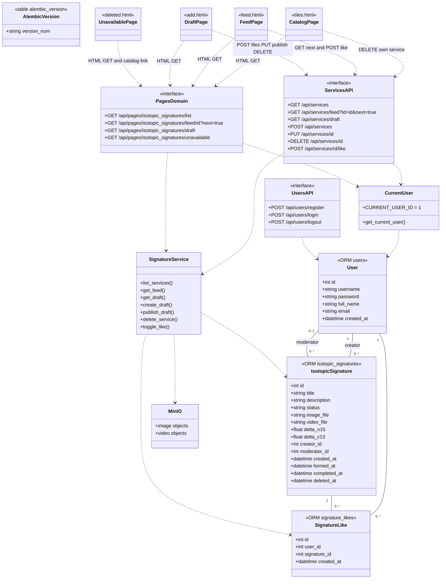

# Диаграмма классов ЛР3

Редактируемая версия по образцу `diagramexample.png`: [architecture_diagram.drawio](architecture_diagram.drawio).
Файл содержит два листа: архитектуру и подробные поля моделей/схем.

Имена таблиц указаны у ORM-моделей. Стрелки от страниц показывают фактические
зависимости: GET формирует HTML через общий сервис, JS вызывает REST API.

`id` в URL диаграммы означает параметр пути `{id}`. Сериализаторы Pydantic:
`ServiceResponse`, `ServiceDraftResponse`, `PublishRequest`, `LikeRequest`,
`UserRegister`, `UserResponse` (`api/schemas.py`). Дополнительные входные поля
запрещены. Отдельной страницы авторизации в ЛР3 нет; login/logout — заглушки API.
Служебные маршруты Swagger/OpenAPI и статика описаны в README.

Лента без query-параметров возвращает первую запись; `id` выбирает запись,
`next=true` — следующую. Это одна из 10 операций JSON API.
`deleted_at` — маркер soft delete; `is_liked` — SQL EXISTS по текущему пользователю.
