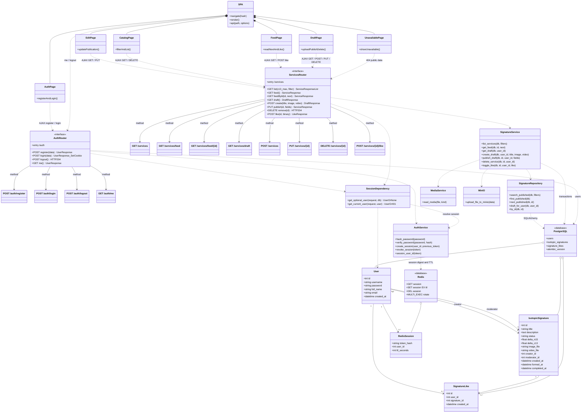

# Общая диаграмма классов бэкенда и SPA · ЛР4

Одна диаграмма: 3 предметные модели, Redis-сессия, PostgreSQL, Redis, MinIO,
4 основных экрана SPA, экран авторизации и редактирование публикации. APIRouter — входные точки
интерфейсов с ответвлениями к методам (12 методов API).

[Открыть готовую диаграмму SVG](lr4_architecture.svg).

Входные точки — `AuthRouter` (`/auth`) и `ServicesRouter` (`/services`).
От каждой проведены отдельные стрелки к узлам всех 12 методов API.
Связь SPA → APIRouter использует fetch/JSON и multipart для медиа;
сессия передаётся в cookie, а объекты MinIO — бинарными файлами.
Все изменения авторства/состояния вычисляются на стороне сервера.
