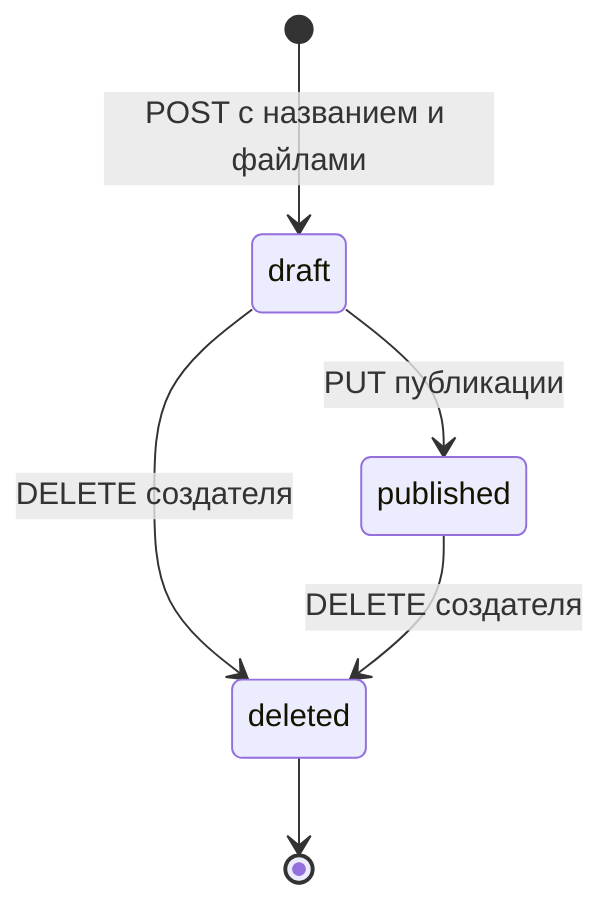
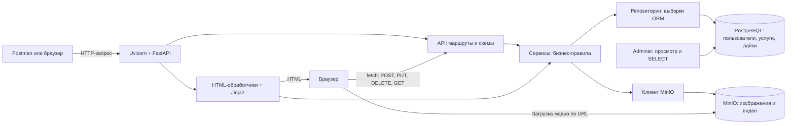
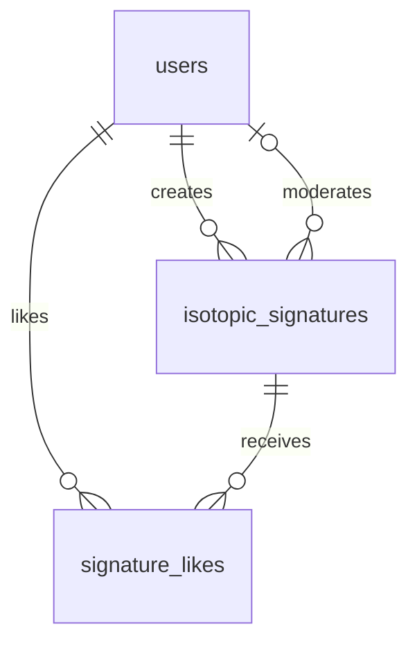

# Подготовка к защите ЛР3 — IsoArch

**Вариант 18 · Веб-сервис изотопных сигнатур костных останков**

Этот документ объясняет проект с нуля. Он связывает предметную область, устройство программы, HTTP-запросы, таблицы PostgreSQL, хранение файлов и требования лабораторной. Здесь же находятся ответы на контрольные вопросы и примеры объяснений для защиты.

Описание сверено с текущими исходниками проекта. Примеры с ID `7` иллюстрируют сценарий: в другой БД номер новой записи может отличаться. Даты, UUID и значения счётчиков в примерах не являются гарантированным результатом каждого запуска. Сохранившиеся данные предыдущих лабораторных также могут отличаться от первоначальных демонстрационных данных.

## Как читать

При первом знакомстве прочитай разделы последовательно: сначала станет понятно, **что хранится**, затем **кто за что отвечает**, после этого — **как проходит запрос**. Перед защитой удобно перечитать разделы с контрольными вопросами, вопросами преподавателя и готовым рассказом.

Документ самодостаточен: основные понятия объяснены здесь. Ссылки на файлы позволяют найти подтверждение в коде, а ссылки на стандарты — уточнить общую теорию.

## Содержание

1. [Предметная область и цель лабораторной](#s01)
2. [Основные понятия без предположения о предыдущем опыте](#s02)
3. [История одной услуги от создания до удаления](#s03)
4. [Общая архитектура и участники системы](#s04)
5. [Структура проекта: назначение папок и файлов](#s05)
6. [PostgreSQL, модели и связи таблиц](#s06)
7. [Статусы, права и системные поля](#s07)
8. [Текущий пользователь, Depends и смысл singleton](#s08)
9. [Сериализаторы и проверка данных](#s09)
10. [ORM, сессия, транзакция и ограничения БД](#s10)
11. [MinIO: загрузка, имена объектов и ошибки](#s11)
12. [Все методы API с примерами](#s12)
13. [Полное прохождение запроса через программу](#s13)
14. [Четыре страницы и JavaScript](#s14)
15. [Запуск, Docker, миграции и первоначальные данные](#s15)
16. [Проверки, Postman и скриншоты 1–17](#s16)
17. [Контрольные вопросы: веб-сервис, REST и RPC](#s17)
18. [Контрольные вопросы: HTTP, заголовки и методы](#s18)
19. [Контрольные вопросы: версии HTTP и HTTPS](#s19)
20. [Контрольные вопросы: OSI и ISO](#s20)
21. [Вопросы преподавателя и ответы по нашему коду](#s21)
22. [Разбор типичных ошибок и непонятных ответов](#s22)
23. [Что реализовано и где проходят границы ЛР3](#s23)
24. [Готовый рассказ и последовательность защиты](#s24)
25. [Словарь терминов и карта требований](#s25)
26. [Первоисточники и файлы для дальнейшего изучения](#s26)

---

<a id="s01"></a>
## 1. Предметная область и цель лабораторной

### 1.1. Что такое IsoArch

IsoArch — учебное приложение для хранения описаний изотопных исследований костных останков. Представим археолога, который исследовал образец из погребения. У него есть название исследования, измеренные показатели, текстовое описание и материалы, которыми можно сопроводить публикацию: изображение и короткое видео.

В лабораторном задании такая запись называется **услугой**. В нашем варианте услуга — карточка изотопного исследования. Поэтому общий API называется `/api/services`, а конкретная модель и таблица — `IsotopicSignature` и `isotopic_signatures`.

Это два названия одного предметного объекта на разных уровнях:

| Название | Где встречается | Значение |
|---|---|---|
| Услуга / service | Требования ЛР и URL `/api/services` | Общий термин задания |
| Изотопная сигнатура / isotopic signature | Код, таблица, интерфейс | Услуга нашего варианта |
| Запись / карточка | Объяснение сценариев | Экземпляр услуги с конкретным ID |

Пример карточки:

```text
Название: Погребение №14 (Бронза)
Описание: результаты исследования и описание реконструкции рациона
δ¹⁵N: 9.4 ‰
δ¹³C: −18.2 ‰
Фото: изображение образца
Видео: короткий ролик об исследовании
Создатель: пользователь №1
Статус: опубликована
```

### 1.2. Что означают показатели

`delta_n15` соответствует показателю δ¹⁵N, `delta_c13` — δ¹³C. В интерфейсе значения показываются в промилле — `‰`. Для понимания программы достаточно знать, что это два числовых результата исследования, которые пользователь вводит при публикации.

**Программа не вычисляет рацион автоматически и не делает научное заключение по числам.** Она сохраняет введённые показатели и текст исследователя. Демонстрационные описания и медиа служат учебному сценарию; не следует представлять их как проверенные результаты реальной экспертизы.

### 1.3. Что добавляет ЛР3

Задача ЛР3 — предоставить бизнес-логику через веб-сервис. Пользователь должен работать с данными не только через готовую HTML-страницу, но и через HTTP API: например, из Postman или будущей SPA.

В этой работе реализованы:

- получение опубликованных услуг с фильтрацией;
- просмотр ленты и переход к следующей публикации;
- получение собственного черновика;
- создание черновика с двумя файлами;
- публикация;
- логическое удаление своей услуги;
- установка и отмена лайка;
- регистрация пользователя;
- заглушки входа и выхода;
- общая функция получения фиксированного текущего пользователя.

Требования зафиксированы в [ЛР3.txt](ЛР3.txt). Полноценная авторизация вынесена за пределы этой лабораторной.

### 1.4. Что сказать в начале защиты

> Мой вариант посвящён изотопным исследованиям костных останков. Услуга — это карточка исследования с описанием, значениями δ¹⁵N и δ¹³C, изображением и коротким видео. В ЛР3 я реализовал HTTP API для работы с этими карточками, подключил PostgreSQL через ORM и MinIO для хранения файлов. Проверку методов выполняю через Postman.

---

<a id="s02"></a>
## 2. Основные понятия без предположения о предыдущем опыте

### 2.1. Клиент и сервер

**Клиент** отправляет запрос. В нашем проекте клиентом может быть браузер, Postman или будущая SPA.

**Сервер** принимает запрос, проверяет его, выполняет необходимые действия и возвращает ответ. Серверная программа написана на Python с FastAPI и запускается Uvicorn.

Когда ты нажимаешь Send в Postman, ты не вызываешь Python-функцию прямо из редактора. Postman отправляет сетевое HTTP-сообщение. Сервер по методу и адресу определяет нужный обработчик.

### 2.2. Frontend и backend

**Frontend** — интерфейс, который видит пользователь: страницы, кнопки, поля формы, изображения и видео.

**Backend** — серверная часть, которая решает, можно ли создать запись, кому разрешено её удалить, какие данные сохранить и что вернуть клиенту.

Даже если frontend скрывает кнопку удаления чужой услуги, backend всё равно должен проверять владельца. Пользователь может отправить DELETE вручную через Postman, минуя интерфейс.

### 2.3. API и endpoint

**API** — правила программного взаимодействия. Наш HTTP API описывает доступные адреса, методы, входные поля, ответы и ошибки.

**Endpoint** — конкретная точка API. Например:

```text
GET /api/services/draft
```

Это сочетание метода GET и маршрута `/api/services/draft`. Другой метод по тому же адресу может иметь иной смысл или быть недоступным.

### 2.4. Данные и файлы

Данные карточки — название, числа, статус, даты и ссылки на другие записи — находятся в PostgreSQL. Содержимое фото и видео находится в MinIO. В PostgreSQL сохраняются **имена объектов**, по которым можно найти файлы в MinIO.

Представь библиотеку: PostgreSQL хранит каталог и сведения о книгах, MinIO — сами электронные файлы. Запись каталога сообщает, какой файл относится к какому исследованию.

### 2.5. ID, JSON и NULL

**ID** — идентификатор записи. Услуга с ID `7` и пользователь с ID `7` — разные сущности, потому что находятся в разных таблицах.

**JSON** — текстовый формат данных:

```json
{
  "id": 7,
  "title": "Исследование ЛР3",
  "delta_n15": null
}
```

Число `7` не заключено в кавычки. Строка заключена. `null` означает отсутствие значения.

В Python отсутствие значения обычно представляется `None`, в PostgreSQL — `NULL`, в JSON — `null`. Они относятся к разным средам, но в нашем сценарии передают один смысл: поле ещё не заполнено.

### 2.6. Что значит HTTP 200

`200 OK` означает, что сервер успешно обработал запрос. Это не гарантирует, что найден именно тот объект, который ты ожидал. Нужно читать тело ответа.

Например, GET собственного черновика возвращает `200` и объект, если черновик есть, либо `200` и `null`, если его нет. Оба ответа допустимы.

---

<a id="s03"></a>
## 3. История одной услуги от создания до удаления

Проще всего понять приложение через последовательность действий с одной записью.

### Шаг 1. Просмотр каталога

Пользователь запрашивает список. Сервер показывает только опубликованные услуги. Если передан `c13_max=-15`, отбирает записи с `delta_c13 <= -15`.

### Шаг 2. Создание черновика

Пользователь задаёт название и выбирает фото с видео. Сервер проверяет файлы, загружает их в MinIO и создаёт строку в PostgreSQL.

У новой записи:

```text
status = draft
creator_id = 1
created_at = время создания
formed_at = NULL
completed_at = NULL
```

Описание и изотопные показатели у новой услуги пока не заполнены. Такая запись не появляется в публичном каталоге.

### Шаг 3. Получение черновика

Клиент отправляет GET `/api/services/draft`. ID не нужен: сервер знает текущего пользователя и ищет его единственный черновик.

### Шаг 4. Публикация

Пользователь передаёт описание, δ¹⁵N и δ¹³C. Сервер проверяет владельца и исходный статус, сохраняет значения, устанавливает `published` и заполняет `formed_at`.

Теперь услуга появляется в каталоге и ленте. Собственный GET черновика снова возвращает `null`.

### Шаг 5. Лайк

Пользователь отправляет `{"like": 1}`. В таблице `signature_likes` появляется связь текущего пользователя с услугой. Повтор такого же действия не создаёт второй лайк.

Если отправить `{"like": 0}`, эта связь удаляется. Сама услуга остаётся.

### Шаг 6. Логическое удаление

Создатель отправляет DELETE. Строка услуги остаётся в PostgreSQL, но статус становится `deleted`, а `completed_at` заполняется временем удаления.

Каталог и лента её больше не выдают. Сохранённые имена файлов, сами файлы и уже существующие лайки не уничтожаются этой операцией.



Последняя стрелка означает завершение жизненного цикла в нашем API, а не физическое удаление строки. Метода восстановления нет.

---

<a id="s04"></a>
## 4. Общая архитектура и участники системы

### 4.1. Архитектура в одной схеме



У схемы две важные особенности.

Первая: JSON API и HTML-страницы используют **общую бизнес-логику**, а не два независимых набора правил.

Вторая: браузер получает фото и видео по URL MinIO. Получение JSON карточки и загрузка самого видео — отдельные запросы.

### 4.2. Роль каждой технологии

| Компонент | Простое объяснение | Роль в IsoArch |
|---|---|---|
| Python | Язык программы | Код сервера |
| Uvicorn | Сервер, принимающий HTTP и вызывающий приложение | Запуск FastAPI на порту 8000 |
| FastAPI | Фреймворк веб-приложения | Маршруты, зависимости, HTTP-ответы |
| Pydantic | Проверка структуры данных | Входные и выходные схемы JSON |
| SQLAlchemy | Библиотека работы с БД, включая ORM | Модели, запросы, сессии и сохранение изменений |
| PostgreSQL 16 | Реляционная СУБД | Постоянные таблицы приложения |
| Alembic | Управление изменениями схемы | Переход от старой БД ЛР2 к ЛР3 |
| MinIO | Объектное хранилище | Содержимое файлов фото и видео |
| Jinja2 | Шаблонизатор | Генерация HTML из данных сервера |
| JavaScript | Код браузера | Отправка форм и действий через fetch |
| Docker Compose | Запуск нескольких сервисов | PostgreSQL, Adminer и MinIO |
| Adminer | Веб-интерфейс к БД | SELECT и просмотр изменённых таблиц |
| Postman | HTTP-клиент | Демонстрация и проверка запросов |

### 4.3. Uvicorn и FastAPI — разные части

Uvicorn принимает соединение и передаёт информацию о запросе Python-приложению через интерфейс ASGI. FastAPI определяет, какой маршрут должен обработать этот запрос, разбирает параметры и организует выполнение функции.

Сам по себе файл с `app = FastAPI(...)` ещё не означает, что сервер уже слушает порт. Для обработки сетевых запросов приложение нужно запустить через Uvicorn; у нас это делает `python main.py`.

### 4.4. Является ли приложение микросервисным

Прикладной backend один: FastAPI-приложение. PostgreSQL и MinIO — внешние инфраструктурные сервисы. Наличие нескольких контейнеров само по себе не превращает бизнес-приложение в набор микросервисов.

Нашу серверную часть удобно описывать как **одно приложение со слоями**, которое обращается к БД и объектному хранилищу.

### 4.5. Домены API и сетевые домены

В задании «домен услуги» и «домен пользователя» означают группы методов по предметной области:

```text
/api/services — работа с услугами
/api/users    — регистрация и заглушки авторизации
```

Это не доменные имена DNS. Сетевое имя хоста в локальном запросе — `localhost`, а `/api/services` — путь внутри приложения.

---

<a id="s05"></a>
## 5. Структура проекта: назначение папок и файлов

```text
main.py                          точка входа и запуск приложения
core/
    config.py                    настройки, текущий ID, ограничения файлов
    minio_client.py               работа с объектным хранилищем
api/
    dependencies.py              получение текущего пользователя
    schemas.py                   входные и выходные схемы Pydantic
    services_api.py              HTTP API услуг
    users_api.py                 регистрация, login/logout
    handlers.py                  GET четырёх HTML-страниц
models/
    user.py                      ORM-модель пользователя
    isotopic_signature.py        ORM-модель услуги
    signature_like.py            ORM-модель лайка
repositories/
    isotopic_signatures.py        выборки SQLAlchemy ORM
services/
    isotopic_signatures.py        правила и операции над услугами
    media.py                     проверка файлов и длительности MP4
    presentation.py              поля отображения и URL медиа
 db/
    base.py                      общая база ORM-моделей
    session.py                   engine, сессии и get_db
    migrate.py                   применение миграций при запуске
    seed.py                      демонстрационные записи и медиа
migrations/
    env.py                       подключение Alembic
    versions/0001_lr3.py          обновление схемы ЛР3
 templates/                      четыре страницы и общие фрагменты
static/
    css/styles.css               оформление
    js/services.js               действия через API
    js/media-preview.js          локальный предпросмотр выбранных файлов
    images/, videos/             демонстрационные и запасные медиа
 tests/                          автоматические HTTP-тесты и тесты миграций
scripts/                         проверки реальных сервисов и браузера
 docker-compose.yml              запуск инфраструктуры
postman_collection.json          сценарий из 10 основных запросов
README.md                        краткая документация проекта
```

### 5.1. Контроллер, сервис и репозиторий

**Контроллер** — обработчик HTTP. Он получает параметры, текущего пользователя и сессию БД, вызывает нужный сервис и возвращает результат.

**Сервис** — функция с бизнес-правилами. Например, публикация разрешена только владельцу черновика. Именно здесь решается, какое изменение допустимо.

**Репозиторий** — место, где сосредоточены выборки данных. Например, поиск опубликованных услуг с заданным порогом δ¹³C.

Не каждый метод обязательно проходит через каждый файл в одной и той же форме. Сервис записи также непосредственно использует ORM для `add`, `commit` и изменения полей. Регистрация реализована прямо в `api/users_api.py`, без отдельного сервиса пользователей. Так устроен текущий код; не следует рассказывать о слоях, которых в нём нет.

### 5.2. Зачем разделять ответственность

Разделение позволяет менять внешний HTTP-интерфейс без переписывания правила «удалять может только создатель». Тот же сервис используется браузерной страницей и JSON API. Тест может проверять правило отдельно от оформления HTML.

### 5.3. Файлы предыдущих этапов

`data/collections.py` содержит старую коллекцию данных предыдущей лабораторной. Текущие API и страницы работают через БД, а не через этот список.

`db/raw_queries.py` — оставшийся служебный модуль с пояснением; курсорный обход удаления больше не используется приложением.

`drop_tables.py` — отдельный разрушительный скрипт удаления таблиц. Для обычного запуска и обновления он **не нужен**. Его не следует использовать, чтобы «починить» состояние БД перед сдачей.

`AGENTS.md` хранит этапы исправлений и результаты проверки. Он не является конфигурацией runtime и не влияет на HTTP-запросы.

---

<a id="s06"></a>
## 6. PostgreSQL, модели и связи таблиц

### 6.1. Почему основная СУБД — PostgreSQL

Настройка `DATABASE_URL` по умолчанию указывает на PostgreSQL. В `docker-compose.yml` используется образ `postgres:16-alpine`. Поэтому при обычном запуске данные приложения сохраняются в PostgreSQL.

SQLite используется в изолированных автоматических тестах. Это позволяет быстро создавать тестовую БД в памяти. Наличие SQLite-файла рядом с исходниками само по себе не означает, что работающий сервер использует его: решающей является настройка подключения.

**СУБД** — программа управления данными. **База данных** — конкретный набор таблиц внутри неё. В нашем случае СУБД — PostgreSQL, имя основной БД — `isoarch_db`.

### 6.2. Что такое ORM-модель

Класс `User` описывает таблицу `users`, класс `IsotopicSignature` — `isotopic_signatures`, класс `SignatureLike` — `signature_likes`.

Строка:

```python
__tablename__ = "isotopic_signatures"
```

задаёт имя таблицы. Описание:

```python
id = Column(Integer, primary_key=True, index=True)
```

означает столбец целого типа, первичный ключ и индекс. Поля модели — описание структуры БД, а отдельный объект модели соответствует конкретной строке.

### 6.3. Таблица users

| Поле | Тип в модели | Назначение |
|---|---|---|
| `id` | Integer, PK | Уникальный идентификатор пользователя |
| `username` | String(100), UNIQUE, NOT NULL | Логин |
| `password` | String(255), NOT NULL | Хеш нового пароля либо техническое значение старой/демонстрационной записи |
| `full_name` | String(255), nullable | Имя пользователя |
| `email` | String(255), UNIQUE, nullable | Почта |
| `created_at` | DateTime, NOT NULL | Дата создания пользователя |

`unique=True` означает запрет двух одинаковых непустых значений в соответствующем столбце. Поле email допускает `NULL`: пользователь может зарегистрироваться без почты. В нашей схеме PostgreSQL несколько пользователей могут иметь `email=NULL`.

Новые пользователи получают пароль через функцию `hash_password()`. Сидированные строки `hashed_password_1` и подобные — демонстрационные заглушки, а не результат этой функции. Миграция пользователей ЛР2 без пароля устанавливает `legacy-account`. Проверки входа пока нет.

### 6.4. Таблица isotopic_signatures

| Поле | Тип в модели | Кто задаёт / смысл |
|---|---|---|
| `id` | Integer, PK | БД при вставке новой записи |
| `title` | String(255), NOT NULL | Пользователь при создании |
| `description` | Text, nullable | Пользователь при публикации |
| `status` | String(50), NOT NULL | Сервер: draft / published / deleted |
| `image_file` | String(500), nullable | Сервер сохраняет имя объекта изображения |
| `video_file` | String(500), nullable | Сервер сохраняет имя объекта видео |
| `delta_n15` | Float, nullable | Пользователь при публикации |
| `delta_c13` | Float, nullable | Пользователь при публикации |
| `creator_id` | Integer, FK, NOT NULL | Сервер по текущему пользователю |
| `moderator_id` | Integer, FK, nullable | Зарезервировано; в текущих операциях остаётся NULL |
| `created_at` | DateTime, NOT NULL | Автоматически при вставке через ORM |
| `formed_at` | DateTime, nullable | Сервер при публикации |
| `completed_at` | DateTime, nullable | Сервер при логическом удалении |

`default=datetime.utcnow` — Python-default SQLAlchemy: дата вычисляется при вставке, когда значение не передано. Это не та же конструкция, что серверный SQL-default в PostgreSQL.

Даты приложения сохраняются как значения UTC, но тип `DateTime` здесь не содержит часовой пояс. JSON может показывать время без суффикса `Z`. При сравнении с московским временем нужно учитывать разницу; значение не следует автоматически считать локальным временем интерфейса.

### 6.5. Таблица signature_likes

| Поле | Тип | Назначение |
|---|---|---|
| `id` | Integer, PK | Идентификатор связи |
| `user_id` | Integer, FK, NOT NULL | Кто поставил лайк |
| `signature_id` | Integer, FK, NOT NULL | Какой услуге |
| `created_at` | DateTime, NOT NULL | Когда связь создана |

Лайк — отдельная строка. В услуге не хранится изменяемое поле `likes_count` как самостоятельный столбец: количество вычисляется по связям. Это позволяет узнать не только число лайков, но и то, поставил ли лайк текущий пользователь.

### 6.6. Первичный и внешний ключ

**Первичный ключ — PK** идентифицирует строку в своей таблице. **Внешний ключ — FK** ссылается на строку другой таблицы.

Например:

```python
ForeignKey("users.id", ondelete="RESTRICT")
```

означает, что `creator_id` должен ссылаться на существующего пользователя. БД не должна содержать услугу с создателем, которого нет в `users`.

`RESTRICT` запрещает физически удалить связанную строку, пока на неё есть ссылки. Это правило БД, а не правило отображения кнопки в браузере.

### 6.7. Связи и кардинальности



- Один пользователь может создать много услуг. У каждой услуги ровно один создатель.
- Модератор у услуги необязателен. Если он указан, это один пользователь.
- Пользователь может лайкнуть много услуг; услуга может получить лайки многих пользователей.
- Связь многие-ко-многим реализована через `signature_likes`.

`relationship(...)` помогает работать со связями из Python: например, обратиться к `signature.likes`. Он не заменяет `ForeignKey`: внешние ключи обеспечивают целостность в БД, а relationship даёт удобную навигацию объектам ORM.

### 6.8. Ограничения, которые нельзя обойти обычной гонкой запросов

Услуга содержит CHECK:

```python
CheckConstraint("status IN ('draft', 'published', 'deleted')", ...)
```

Он ограничивает набор допустимых значений, но **сам по себе не проверяет переход между статусами**. Переход проверяет сервис.

Частичный уникальный индекс:

```python
Index(
    "uq_user_single_draft",
    "creator_id",
    unique=True,
    postgresql_where=(status == "draft"),
    sqlite_where=(status == "draft"),
)
```

учитывает только строки `draft`. Следовательно, у пользователя может быть много публикаций и удалённых записей, но только один черновик.

Связь лайка защищена:

```python
UniqueConstraint("user_id", "signature_id", name="uq_user_signature_like")
```

Нельзя вставить две одинаковые пары пользователь–услуга даже двумя конкурентными INSERT.

### 6.9. Служебная таблица

`alembic_version` содержит номер применённой миграции. Это техническая таблица, а не предметная сущность пользователя или услуги.

---

<a id="s07"></a>
## 7. Статусы, права и системные поля

### 7.1. Три состояния

| Статус | Смысл | Где виден |
|---|---|---|
| `draft` | Созданная, ещё не опубликованная услуга | В собственном черновике |
| `published` | Доступная для просмотра публикация | В каталоге и ленте |
| `deleted` | Логически удалённая услуга | В БД, но не в публичных ответах API |

В коде статусы записаны на английском. Миграция преобразует старые русские значения, чтобы модели, запросы и страницы использовали одно обозначение.

### 7.2. Разрешённые переходы

| Исходный статус | Действие | Итог |
|---|---|---|
| `draft` | Публикация владельцем | `published` |
| `draft` | Удаление владельцем | `deleted` |
| `published` | Удаление владельцем | `deleted` |
| `published` | Повторная публикация | 409, состояние не меняется |
| `deleted` | Публикация или повторное удаление | 404, запись скрыта для этой операции |

Метода возврата в `draft` нет. Клиент также не может передать новый статус напрямую.

### 7.3. Проверка владельца

`owned_service()` в `services/isotopic_signatures.py`:

1. Находит запись по ID.
2. Если записи нет или она `deleted`, возвращает 404.
3. Если `creator_id` отличается от ID текущего пользователя, возвращает 403.
4. Возвращает запись для разрешённого изменения.

Публикация дополнительно проверяет, что запись является черновиком. Удаление допускается как для своего черновика, так и для своей публикации.

### 7.4. Зачем is_creator

`is_creator` — вычисляемый признак в ответе, а не отдельный столбец:

```python
int(signature.creator_id == user_id)
```

Если создатель совпадает с текущим пользователем, значение равно `1`, иначе `0`. Интерфейс по нему показывает кнопку удаления только для своих публикаций. Backend при DELETE всё равно повторно проверяет право.

### 7.5. Системные поля

Пользователь не должен выбирать себе ID, создателя, статус, модератора или системную дату.

| Поле | Как определяется |
|---|---|
| `id` | Генерируется БД |
| `creator_id` | Берётся из `current_user.id` |
| `status` | Вычисляется из выполняемой операции |
| `created_at` | ORM-default при создании |
| `formed_at` | Текущее время при публикации |
| `completed_at` | Текущее время при удалении |
| `moderator_id` | Не назначается в методах этой ЛР |

Если разрешить клиенту изменять `creator_id`, он мог бы выдавать себя за другого создателя. Если разрешить `status`, он мог бы обойти последовательность черновик → публикация.

Системные поля могут присутствовать **в ответе** опубликованной услуги. Это не означает, что они разрешены **во входном запросе**.

### 7.6. Что такое soft delete

При удалении выполняется изменение полей ORM:

```python
record.status = "deleted"
record.completed_at = datetime.utcnow()
db.commit()
```

Не выполняется `db.delete(record)` для услуги. Поэтому SELECT из PostgreSQL показывает строку после DELETE API. Это ожидаемый результат, подтверждающий логическое удаление.

Лайк отменяется иначе: `db.delete(existing)` удаляет строку **связи лайка**. Требование soft delete относится к услуге; не нужно путать два разных объекта.

---

<a id="s08"></a>
## 8. Текущий пользователь, Depends и смысл singleton

### 8.1. Почему ID всегда равен 1

ЛР3 исключает полноценную авторизацию. Поэтому в `core/config.py` задано:

```python
CURRENT_USER_ID = 1
```

Функция из `api/dependencies.py` получает эту запись из БД:

```python
def get_current_user(db: Session = Depends(get_db)) -> User:
    user = db.get(User, CURRENT_USER_ID)
    if user is None:
        raise HTTPException(503, "Current user is not initialized")
    return user
```

Она возвращает не просто число, а ORM-объект `User`, у которого есть `.id`, `.username` и другие поля.

### 8.2. Что делает Depends

В обработчике есть параметр:

```python
current_user: User = Depends(get_current_user)
```

Это инструкция FastAPI: перед выполнением обработчика получить результат `get_current_user()` и передать его в `current_user`.

У самой функции есть зависимость `Depends(get_db)`. Поэтому FastAPI сначала получает сессию БД, потом пользователя и только затем выполняет обработчик API. Если пользователя №1 нет, запрос не доходит до создания услуги: зависимость завершает его ошибкой.

### 8.3. Что переиспользуется

В рамках одного запроса FastAPI по умолчанию кэширует результат повторно используемой зависимости. Если `get_db` нужен и обработчику, и `get_current_user`, они получают результат общей зависимости для этого запроса. Подробнее: [документация FastAPI о повторном использовании зависимостей](https://fastapi.tiangolo.com/tutorial/dependencies/sub-dependencies/#using-the-same-dependency-multiple-times).

### 8.4. Как корректно объяснить singleton

В общем программировании Singleton — паттерн, обеспечивающий единственный экземпляр объекта в заданной области жизни.

В лабораторной функция называется «функцией-singleton», поскольку она предоставляет единое место определения текущего создателя. В нашем коде это **общая зависимость с постоянным ID и кэшированием внутри запроса**.

Она не создаёт глобальный вечный объект `User`, общий для всех запросов. В разных сессиях БД объекты Python могут отличаться, хотя каждый представляет пользователя с ID 1. Это различие важно: нельзя приписывать реализации процессный Singleton, которого здесь нет.

Удобная формулировка:

> Текущий пользователь определяется общей функцией get_current_user через константу CURRENT_USER_ID. Все методы используют Depends. FastAPI повторно использует результат зависимости внутри запроса. В следующей лабораторной источник пользователя можно заменить на настоящую авторизацию.

### 8.5. Регистрация не переключает текущего пользователя

Если регистрация создала пользователя №4, следующий POST услуги всё равно установит `creator_id=1`. Login — заглушка и не создаёт сессию. Заголовок Authorization также не обрабатывается нашей заглушкой.

Следовательно, в этой лабораторной нельзя «войти под пользователем №2» обычным запросом login. Проверка чужого удаления демонстрируется на существующей записи другого создателя.

---

<a id="s09"></a>
## 9. Сериализаторы и проверка данных

### 9.1. Почему модель БД и схема API различаются

ORM-модель описывает хранение. Схема API описывает, какие данные можно принять или вернуть. Если отправлять всю модель пользователя без ограничения полей, клиент мог бы получить пароль. Если принимать всю модель услуги для обновления, клиент мог бы менять создателя.

В FastAPI роль сериализаторов выполняют Pydantic-модели из `api/schemas.py`. Они проверяют структуру данных и участвуют в формировании ответа. Общая теория моделей и преобразования данных описана в [документации Pydantic](https://pydantic.dev/docs/validation/latest/concepts/models/).

| Класс | Использование |
|---|---|
| `InputModel` | Общие правила входных JSON-схем |
| `UserRegister` | Вход регистрации |
| `UserResponse` | Выход регистрации без пароля |
| `PublishRequest` | Вход публикации |
| `LikeRequest` | Вход установки/отмены лайка |
| `ServiceDraftResponse` | Выход получения/создания черновика |
| `ServiceResponse` | Выход списка, ленты и публикации |

### 9.2. Что означает extra="forbid"

```python
model_config = ConfigDict(
    extra="forbid",
    str_strip_whitespace=True,
    allow_inf_nan=False,
)
```

`extra="forbid"` отклоняет лишние поля. Например, `PublishRequest` разрешает только описание и два числа. Добавление `creator_id` вызывает 422, а не изменение владельца.

`str_strip_whitespace=True` удаляет пробелы по краям входных строк. Настройка общая и действует в том числе на пароль в `UserRegister`; хеширование получает уже проверенное и преобразованное значение.

`allow_inf_nan=False` запрещает бесконечность и NaN в числовых JSON-полях. Числовые показатели должны быть конечными.

### 9.3. Проверка публикации

```python
class PublishRequest(InputModel):
    description: str = Field(min_length=1, max_length=10000)
    delta_n15: float
    delta_c13: float
```

Описание обязательно и не должно стать пустым после обработки. Оба числа обязательны. Эта схема не устанавливает научный диапазон показателей: в ней нет, например, правила «δ¹⁵N от такого-то до такого-то значения».

### 9.4. Проверка лайка

```python
class LikeRequest(InputModel):
    like: Annotated[StrictInt, Field(ge=0, le=1)]
```

`StrictInt` означает именно целое число. Разрешены `0` и `1`; строка `"1"`, логическое `true`, число `2` или `-1` отклоняются.

Это важно, потому что визуально похожие значения JSON относятся к разным типам.

### 9.5. Схемы ответа

`ServiceDraftResponse` содержит ID, название, описание, два числа и имена файлов. Поэтому в ответе черновика нет поля `status`, хотя в таблице оно есть: схема сознательно ограничивает представление.

`ServiceResponse` наследует поля черновика и добавляет системные поля, признаки создателя и лайка, количество лайков и URL медиа. Его `status` ограничен `Literal["published"]`.

`UserResponse` не содержит password. Пароль не появляется в ответе регистрации, хотя ORM-объект пользователя имеет соответствующее поле.

### 9.6. from_attributes и response_model

`from_attributes=True` позволяет читать поля из атрибутов Python-объекта, например ORM-модели. Схему не обязательно заполнять вручную по одному полю.

В декораторе:

```python
@router.get("/", response_model=list[ServiceResponse])
```

`response_model` определяет форму ответа. Лишние поля словаря представления, например `delta_n15_display`, не включаются в JSON этой схемы. HTML-шаблон при этом может использовать такие поля для вывода `9.4 ‰`.

### 9.7. Multipart проверяется отдельно

POST создания принимает `Form` и `UploadFile`, а не `PublishRequest`. Для него `validate_create_fields()` разрешает только `title`, `image`, `video` и отклоняет лишние или повторяющиеся поля формы. Так защита системных полей действует и при загрузке файлов.

### 9.8. Безопасное сообщение об ошибке

`main.py` содержит обработчик `RequestValidationError`. Он возвращает `loc`, `msg`, `type`, но не повторяет исходное входное значение. Это позволяет вернуть понятную ошибку 422 без попытки сериализовать Infinity и без вывода секретного поля запроса в ответе.

